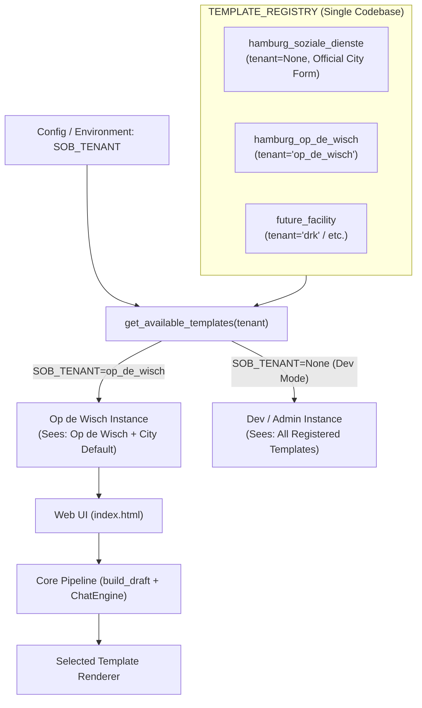

# Implementation Plan: Tenant-Scoped Multi-Template Architecture (Op de Wisch)

**Date:** 2026-09-09  
**Status:** Approved / In Progress  
**Issue:** [#63](https://github.com/GogaKaviladze/sob-generator/issues/63)  
**Target Branch:** `feature_op_de_wisch_template`

---

## 1. Goal Description
Extend the application to support **Op de Wisch** (`templates/hamburg/OpDerWisch/FO_SVB_Berichtsvorlage_2026.docx`) alongside the official Hamburg city template (`templates/hamburg/Vorlage.docx`) within a **single unified codebase**, while ensuring strict **tenant isolation**:
- Different facilities (*Träger*) cannot see or access each other's custom templates.
- Active templates are scoped via deployment configuration (`SOB_TENANT`).
- Adding future facilities requires zero core-pipeline changes (Open/Closed Principle).

---

## 2. Multi-Tenancy & Privacy Model

### Privacy & Scoping Rules
1. **Tenant Isolation:**
   - When deployed for Op de Wisch (`SOB_TENANT=op_de_wisch`), only Op de Wisch's template (and optionally the official city standard) is visible or accessible.
   - Any API request attempting to use another facility's `template_key` is rejected with HTTP 403.
2. **Dev / Admin Mode:**
   - If `SOB_TENANT` is not set or set to `all`, all templates are accessible in the UI dropdown for local testing.
3. **Single-Template Auto-Selection:**
   - If a tenant configuration yields only one template, the UI hides the dropdown and uses that template automatically.

---

## 3. Technical Comparison

| Component | Standard Hamburg (`Vorlage.docx`) | Op de Wisch (`FO_SVB_Berichtsvorlage_2026.docx`) |
| :--- | :--- | :--- |
| **Tenant** | `None` (Public / Official City Standard) | `op_de_wisch` |
| **Sections (9)** | 1.1 Wohnsituation, 1.2 Alltägliche Lebensführung, 1.3 Basisversorgung, 1.4 Emotionale/psychische Entwicklung, 1.5 Gesundheitsförderung, 2.1 Soziale Beziehungen, 2.2 Kulturelles Leben, 2.3 Kommunikation, 3 Arbeit/Beschäftigung | 1 Psychische Verfassung / Selbstsorge, 2 Alltagsgestaltung / Tagesstruktur, 3 Gesundheit, 4 Wohnen, 5 Finanzen / Institutionen, 6 Sozialer Lebensraum, 7 Arbeit / Beschäftigung / Ausbildung, 8 Zusammenarbeit, 9 Sonstiges |
| **Section Fields** | 7 fields: `previous_goals_apply`, `leitziel`, `smarte_ziele`, `bericht_zielerreichung`, `vorschlag_ziele`, `vorschlag_massnahmen`, `realisierung_andere` | Identical 7 fields across all 9 section tables |
| **Word Format** | Legacy form fields (`w:fldChar` / `FORMTEXT`) wrapped in bookmarks | Word tables (Tables 1–9) with paragraph cells + Content Controls (`w:sdt`) in Table 0 header |
| **Rendering** | `HamburgDocxRenderer` via `docx_fields.py` | `OpDeWischDocxRenderer` via table cell & SDT population |

---

## 4. Proposed Changes

### A. Section Definitions
- **`sob_generator/llm/sections_op_de_wisch.py` [NEW]**:
  Define `OP_DE_WISCH_SECTION_DEFINITIONS` with IDs `"1"` through `"9"` and domain descriptions tailored for LLM classification (Pass 0) and section drafting.

### B. Document Rendering Layer
- **`sob_generator/renderers/base.py` [NEW]**:
  Define `BaseDocxRenderer` protocol (`render(draft: ReportDraft, output_path: Path) -> Path`).
- **`sob_generator/renderers/op_de_wisch_renderer.py` [NEW]**:
  Implement `OpDeWischDocxRenderer`:
  - Table 0 (Header): Fills client data, birth date, address, GdB, care level, service type, period, developments, caseworker info while preserving static Op de Wisch address.
  - Tables 1–9 (Sections): Fills `entfällt` checkbox, Leitziel, S.M.A.R.T. goals, report text (with review/no-entries hints), suggestions, measures (bullets), and external implementation.
- **`sob_generator/renderer.py` [MODIFY]**:
  Refactor existing `DocxRenderer` to implement `BaseDocxRenderer` as `HamburgDocxRenderer`.

### C. Template Registry & Tenant Scoping
- **`sob_generator/report_template.py` [MODIFY]**:
  - Extend `ReportTemplate` dataclass:
    - `tenant: Optional[str] = None`
    - `renderer_factory: Callable[[Path], BaseDocxRenderer]`
  - Register `hamburg_op_de_wisch` with `tenant="op_de_wisch"`.
  - Add `get_available_templates(tenant: Optional[str] = None) -> dict[str, ReportTemplate]`:
    Returns templates matching the given tenant plus generic templates (`tenant=None`).

### D. Job Store & Chat Session State
- **`app/jobs.py` [MODIFY]**:
  Add `template_key: str` to `JobState` and `JobStore.create`.
- **`sob_generator/chat_session.py` [MODIFY]**:
  Add `template_key: str` to `ChatSession`.

### E. Application Routes & UI (Tenant-Aware)
- **`app/main.py` [MODIFY]**:
  - Read `SOB_TENANT` from environment (defaulting to `None` for dev mode).
  - `/`: Pass only `get_available_templates(SOB_TENANT)` to `index.html`.
  - `/generate` & `/chat/start`: Validate that submitted `template_key` is permitted under `SOB_TENANT`. Raise 403 if invalid.
  - `/jobs/{job_id}/export` & `/chat/{session_id}/export`: Use the renderer factory from the job/session's template.
- **`app/templates/index.html` [MODIFY]**:
  - If multiple templates are available: render `<select name="template_key">`.
  - If only one template is available: render a hidden input `name="template_key"` and display a clean badge (e.g. "Vorlage: Op de Wisch e.V.").

---

## 5. Verification Plan

### Automated Tests
1. **Tenant Scoping Tests** (`tests/test_template_registry.py`):
   - Verify `get_available_templates("op_de_wisch")` returns only Op de Wisch and city default.
   - Verify `get_available_templates("drk")` does NOT return Op de Wisch.
   - Verify `get_available_templates(None)` returns all templates.
2. **Op de Wisch Renderer Tests** (`tests/test_op_de_wisch_renderer.py` [NEW]):
   - Render a synthetic `ReportDraft` into `FO_SVB_Berichtsvorlage_2026.docx`.
   - Verify output file validity and cell contents (client, developments, 9 section tables).
3. **Route Security & Selection Tests** (`tests/test_app_template_selection.py` [NEW]):
   - Test generating report with allowed vs unauthorized `template_key`.
   - Verify export produces expected `.docx` for each template.
4. **Full Regression Run:**
   - Execute `pytest -q` to confirm all 280 existing tests pass + new tests pass.

### Manual Verification
1. Test with `SOB_TENANT=op_de_wisch`: Verify only Op de Wisch (and Hamburg default) appears in UI.
2. Generate an Op de Wisch SOB and inspect the downloaded `.docx` in Word.
